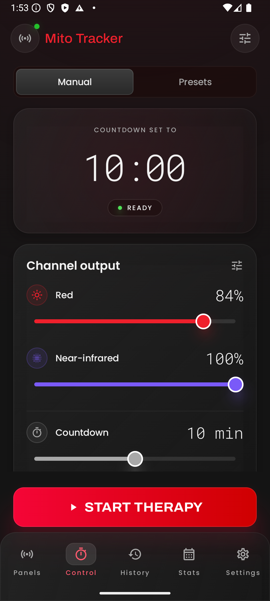
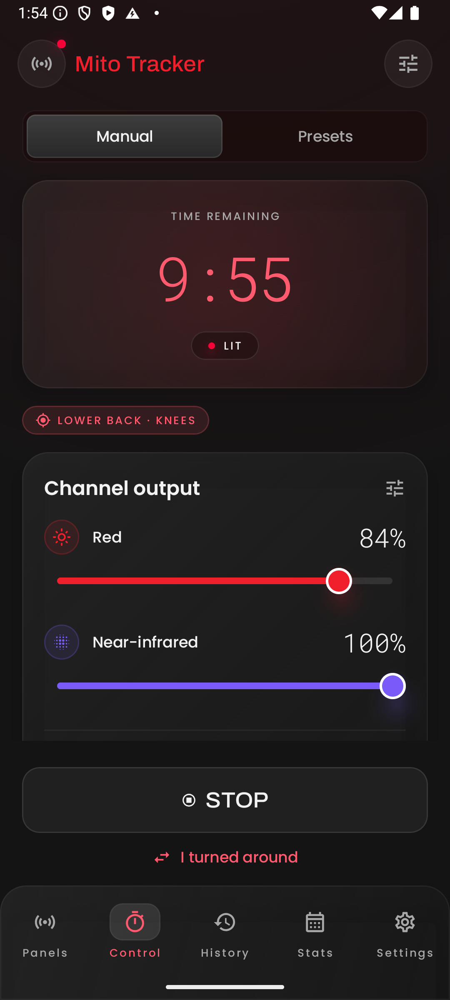
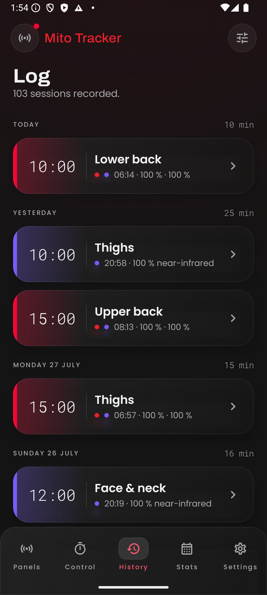
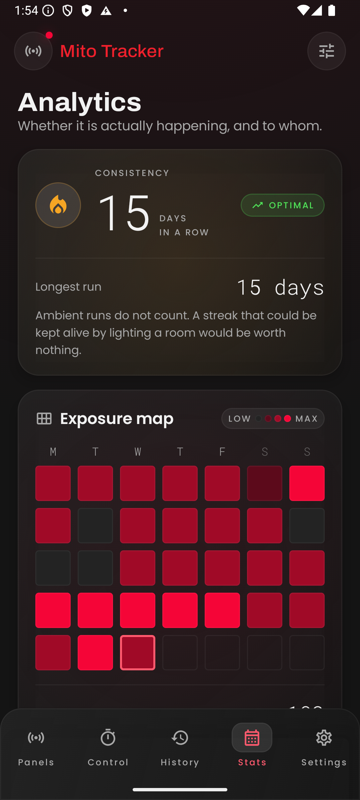

# Mito Tracker

An independent Android app for **Mito Light** red light therapy panels: it drives the panel over
Bluetooth LE and keeps the record the hardware cannot, which is how many minutes each part of the body
has had and whether that stays within the manufacturer's own daily limits.

<p>
  
  
  
  
</p>

## What it does

- **Finds and remembers panels.** Scans for Mito Light units, remembers the ones you use, and reconnects
  to them by address without scanning again.
- **Drives the light.** Per-channel brightness (red and near-infrared; the six-wavelength 5.0 range is
  recognised but only partly implemented and untested on hardware), a countdown, start, stop, pause and resume.
- **Survives a locked phone.** The connection belongs to the app, not a screen. A foreground service
  holds it while the panel is lit and shows the remaining time and a Stop button in the notification.
- **Treats the panel as the source of truth.** On every connect the app reconciles with what the
  hardware reports, so sessions started from the panel's touchscreen are picked up, not lost.
- **Keeps a logbook.** Each session is credited to one or more body areas after it ends, including
  "turned around halfway through". Daily dose per area and streaks are derived from that history and
  never stored as numbers of their own. History is kept in memory for now, seeded with generated data;
  a SQLDelight database is the next step.
- **Presets.** Named routines covering area, brightness and countdown, with sensible defaults for both
  panel generations.
- **Runs without hardware.** A built-in simulator behaves like a real panel, so every screen can be
  used, tested and demonstrated without a device in the room.
- English and Czech.

## How it is built

Kotlin, Jetpack Compose and [Kable](https://github.com/JuulLabs/kable) for BLE. The code is split into
modules so that everything below the UI stays free of Android APIs and could move to Kotlin
Multiplatform later:

| Module | Contents |
| --- | --- |
| `protocol` | Frame encoding and decoding, commands, status parsing. Pure Kotlin. |
| `panel` | The `Panel` interface, the Bluetooth implementation and the simulator. |
| `domain` | Sessions, exposures, areas, dose, limits and presets. Pure Kotlin. |
| `app` | The Android app: Compose UI, the connection service and settings. |

Alongside the app there is a small **Python driver** (`mitolight/`) and command line tool
(`tools/mito.py`) built on [bleak](https://github.com/hbldh/bleak). It is handy for poking at a panel
from a laptop.

The reasoning behind the bigger choices is written up as short decision records in
[`docs/adr/`](docs/adr/). The vocabulary the code uses is in [`CONTEXT.md`](CONTEXT.md), and the visual
system is in [`DESIGN.md`](DESIGN.md).

## Building

You need the Android SDK and **JDK 17 or newer**. The JDK that ships with Android Studio works.

The panel expects an authentication value before it accepts commands. It is **not included in this
repository**. Put it in `local.properties`, which git ignores:

```properties
mitolight.authPassword=<value>
```

Then:

```powershell
.\gradlew.bat :app:installDebug   # onto a connected device or emulator
.\gradlew.bat test                # unit tests for every module
```

Without the value the app still builds, and the simulator works fully; only real panels will refuse it.
To try it with no hardware, pick **Simulator** on the Panels screen. History and Stats are seeded with
generated data so they are worth looking at from the first run.

## Python driver

```powershell
py -m venv .venv
.\.venv\Scripts\python.exe -m pip install -r requirements.txt

$env:MITOLIGHT_AUTH_PASSWORD = "<value>"
.\.venv\Scripts\python.exe tools\mito.py scan
$env:MITOLIGHT_ADDRESS = "<address from scan>"
.\.venv\Scripts\python.exe tools\mito.py status
.\.venv\Scripts\python.exe tools\mito.py on --red 50 --nir 50 --minutes 10
.\.venv\Scripts\python.exe tools\mito.py off
```

```python
import asyncio
from mitolight import MitoLight

async def main():
    async with MitoLight("AA:BB:CC:DD:EE:FF") as panel:
        print(await panel.status())
        await panel.run(red=50, nir=50, minutes=10)

asyncio.run(main())
```

A panel accepts one connection at a time and stops advertising while it has one, so close the official
app and turn Bluetooth off on the phone first.

Tests:

```powershell
.\.venv\Scripts\python.exe tests\test_protocol.py
.\.venv\Scripts\python.exe tests\test_parse_btsnoop.py
```

The `tools/` folder also has small general-purpose BLE helpers: scanning, GATT dumps, notification
listening, and reading Android HCI snoop logs without Wireshark.

## Documentation

- [`docs/protocol.md`](docs/protocol.md): the BLE command set and frame format
- [`docs/adr/`](docs/adr/): architecture decision records
- [`CONTEXT.md`](CONTEXT.md): domain vocabulary (panel, session, exposure, area, dose, …)
- [`DESIGN.md`](DESIGN.md): colour, type and component tokens
- [`docs/design/`](docs/design/): the design sketches and screenshots of what was built from them

## Disclaimer

This is an independent, unofficial project. It is not affiliated with, endorsed by or supported by
Mito Light or its makers. "Mito Light" and "MITO LIGHT" are trademarks of their respective owner and
are used here only to say which hardware the software works with. The protocol was documented for
interoperability with hardware the author owns.

Use it at your own risk. It is not a medical device and gives no medical advice. Dose limits shown
in the app come from the manufacturer's published manual; follow the manufacturer's guidance for your
own panel.

## License

[MIT](LICENSE) © 2026 Pavel Veselý
